<picture>
  <source media="(prefers-color-scheme: dark)" srcset="./assets/singularity-hero-dark.svg">
  
</picture>

<b>S.I.Shuvo</b> · Building innovations for the future I want to live in.

 

#### Telemetry

<picture>
  <source media="(prefers-color-scheme: dark)" srcset="./assets/singularity-telemetry-dark.svg">
  
</picture>

Reading the instruments

- **Accretion disk:** one particle per day of the last year; brighter and closer to the hole means a busier day. Inner rings orbit faster, as they would around a real black hole.
- **Orbit:** contributions per month, plotted as a closed trajectory; the beacon marks the busiest month.
- **Spectral composition:** language share by bytes across public repositories.
- **Light theme:** rendered as a photographic negative, the way astronomical survey plates were printed.

Artwork: original animated SVG, generated by README Templates · template: Singularity. Motion stops if your system asks for reduced motion.

#### Flight log

- `MSN-01` **[Bulz](https://github.com/Shuvo-code-dev/Bulz)** · 🛠️ Halqa | All-in-one Dev Suite. Features interactive Web/Mobile Roadmaps, Framer Motion UI Components, and Public API Directory. The ultimate resource for Next.js, React, and Full-stack developers.  
  TypeScript · ★ 1
- `MSN-02` **[Tracer](https://github.com/Shuvo-code-dev/Tracer)** · Single-file, zero-dependency UTM campaign link generator with quick presets and SEO-friendly clean URL slug maker.  
  HTML
- `MSN-03` **[Vhiper](https://github.com/Shuvo-code-dev/Vhiper)** · Single-file, zero-dependency Bangladeshi mobile number validator, formatter (+8801 / 01), deduplicator, and operator detector (GP, Robi, Airtel, Banglalink, Teletalk).  
  HTML
- `MSN-04` **[Whiteboard](https://github.com/Shuvo-code-dev/Whiteboard)** · Lightweight, single-file, zero-dependency HTML5 Canvas whiteboard for freehand mouse/touch sketching, undo, eraser, and PNG export.  
  HTML

<picture>
  <source media="(prefers-color-scheme: dark)" srcset="./assets/singularity-end-dark.svg">
  
</picture>

